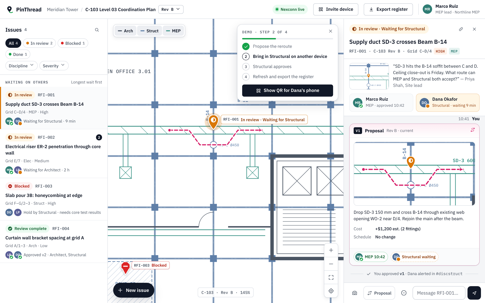

# PinThread

Construction drawing reviews, threaded at the spot where the clash was found. Built on Nexconn Chat.

A pin on a drawing opens a Nexconn conversation with the drawing crop, the proposed fix, and the reviewers whose sign-off is still needed. When the last required reviewer approves the same proposal on the same revision, the pin turns green on everyone's drawing.

- Product concept: [`docs/PRODUCT_SPEC.md`](docs/PRODUCT_SPEC.md)
- Build plan: [`docs/IMPLEMENTATION_PLAN.md`](docs/IMPLEMENTATION_PLAN.md)
- UI design: [`docs/UI_DESIGN.md`](docs/UI_DESIGN.md) (mockups in [`design/screens/`](design/screens))

