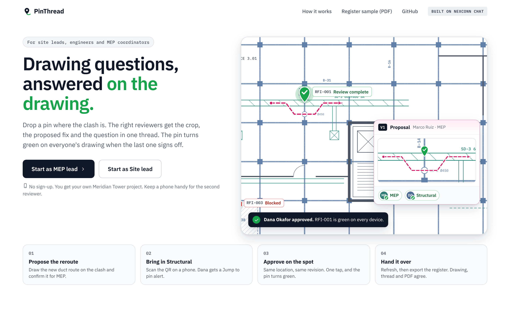
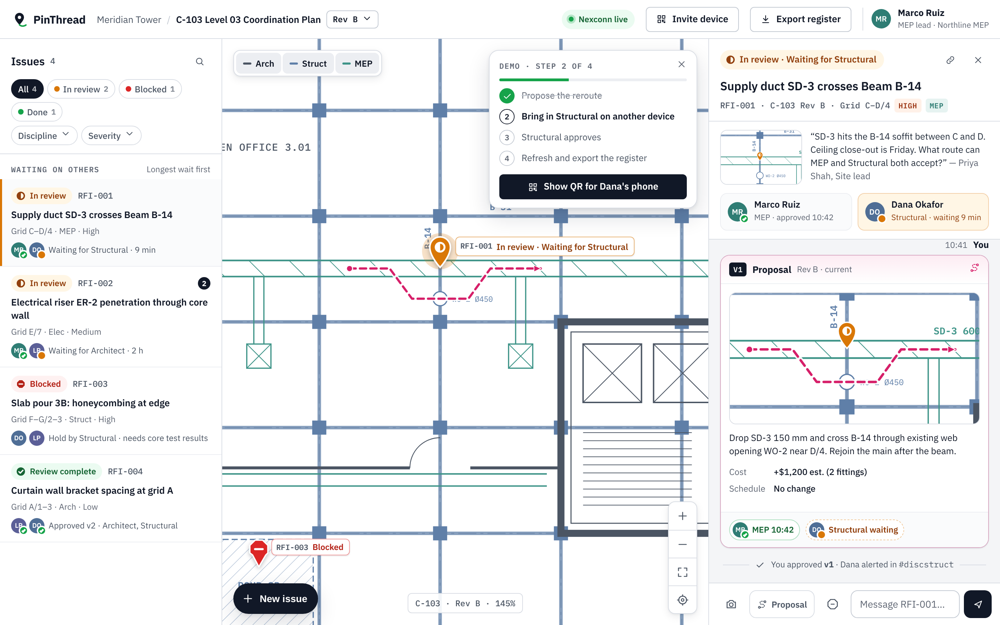
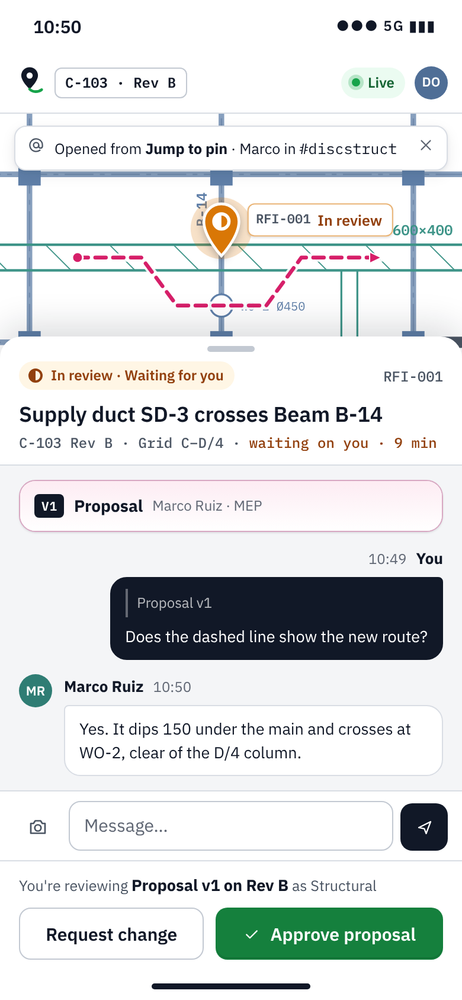
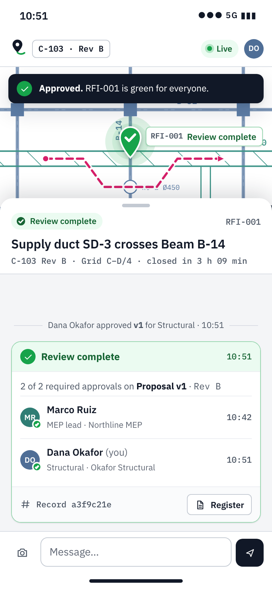
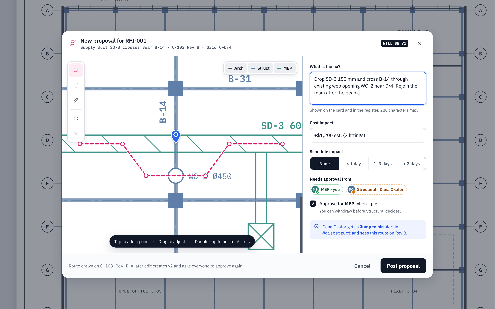
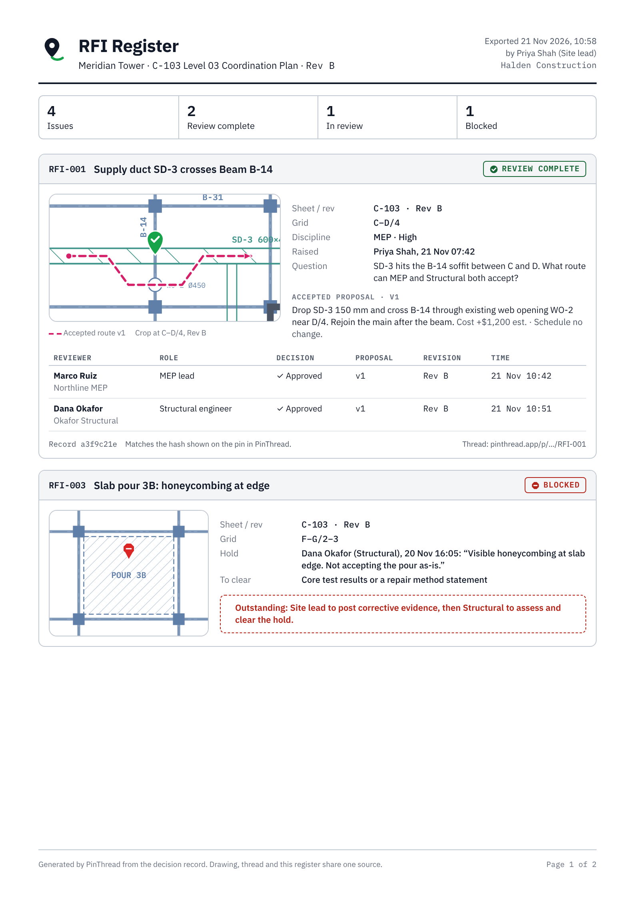
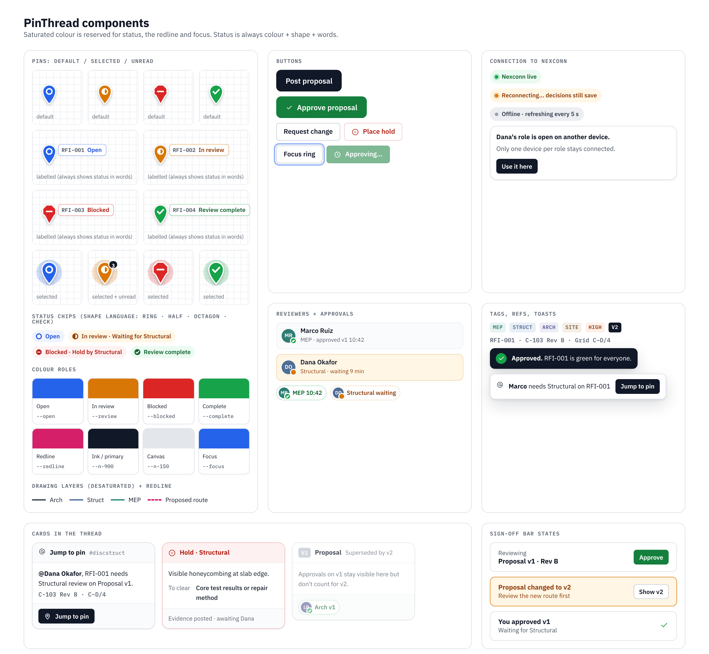

# PinThread: UI Design Specification

Companion to [`IMPLEMENTATION_PLAN.md`](./IMPLEMENTATION_PLAN.md) §7. Half the judging score is "it works from start to end and is easy to use," so this document defines exactly what the judge sees, touches, and understands at every step.

Mockups are real HTML built from the same tokens the app will use. They live in [`design/mockups/`](../design/mockups) and are rendered to [`design/screens/`](../design/screens) with `node design/render.cjs`. The drawing sheet is generated by [`assets/meridian/build-sheet.mjs`](../assets/meridian/build-sheet.mjs). Its geometry (pin positions, the proposed route) is the same data the seeder will use.

| | |
| --- | --- |
|  |  |
|   |  |

---

## 1. Design principles

1. **The drawing is the interface.** Every conversation is anchored to a spot on a sheet. Panels never fully cover the drawing: on mobile the room is a bottom sheet, on desktop a side panel. The pin stays visible while you talk about it.
2. **Saturation means status.** Drawing linework is desaturated (graphite, steel blue, teal). Only four things are vivid: the four status colours, the magenta redline, the focus ring, and the green Approve button that turns pins green. A judge learns the colour code in one glance.
3. **Say it in words.** Status is always **colour + shape + text**: ring = Open, half = In review, octagon = Blocked, check = Review complete. Labels name the person you're waiting for ("In review · Waiting for Structural"), not just the state.
4. **One next action per role.** Each screen makes the viewer's next step the most prominent thing:
   - MEP sees "Show QR for Dana's phone"
   - Dana sees "Approve proposal"
   - The site lead sees "Export register"
   - Nobody hunts.
5. **Name the version and revision at the moment of decision.** The sign-off bar always reads "Reviewing Proposal v1 on Rev B." An approval is visibly tied to what was on screen, which is the integrity story judges will probe.
6. **Field-ready.**
   - Thumb-reachable actions on phones, 44 px minimum targets, 16 px inputs (no iOS zoom)
   - High-contrast light theme for daylight use
   - Graceful behaviour when the network drops

---

## 2. Brand

- **Name and mark:** a black pin with a green thread trailing from its tip: the question, and the line that resolves it. The mark is used at 24–34 px. The wordmark is IBM Plex Sans Bold.
- **Voice:** site language, plain and specific. Say "Waiting for Structural," not "Pending approval." Say "Hold by Structural · needs core test results," not "Status: blocked." Avoid exclamation marks. Numbers and identifiers are set in mono.
- **Typefaces:**
  - **IBM Plex Sans** for UI
  - **IBM Plex Mono** for identifiers (RFI-001, C-103, Rev B, grid refs, times, hashes), with slashed zero
  - The engineering-document heritage fits the domain, and both are open-licensed. Self-host them in production via `@fontsource/ibm-plex-sans` / `@fontsource/ibm-plex-mono`; mockups use Google Fonts.
- **Icons:** Lucide (stroke 1.8, round joins). Mapping in §11.

---

## 3. Tokens

Source of truth: [`design/mockups/tokens.css`](../design/mockups/tokens.css). Map these into Tailwind as CSS variables (§11).

### 3.1 Colour roles

| Role | Token | Value | Use | Contrast |
| --- | --- | --- | --- | --- |
| Open | `--open` / `-weak` / `-text` | `#2563EB` / `#EEF3FF` / `#1D4ED8` | Pin, chip | chip text 6.0:1 |
| In review | `--review` / `-weak` / `-text` | `#D97706` / `#FFF6E5` / `#92400E` | Pin, chip, waiting reviewer | chip text 6.6:1 |
| Blocked | `--blocked` / `-weak` / `-text` | `#DC2626` / `#FEF1F1` / `#B42318` | Pin, hold card, outstanding action | chip text 6.0:1 |
| Review complete | `--complete` / `-weak` / `-text` | `#16A34A` / `#EBFBF1` / `#166534` | Pin, decision card | chip text 6.7:1, pin 3.3:1 (non-text ≥ 3:1) |
| Approve button | `--complete-strong` | `#15803D` | Approve fill | white text 5.0:1 (the pin green would fail at 3.3:1) |
| Redline | `--redline` | `#D61F69` | Proposed routes, proposal card accent | 4.9:1 on white |
| Ink | `--n-900` | `#111827` | Text, primary buttons, unread badges | 17.7:1 |
| Secondary / tertiary text | `--n-600` / `--n-500` | `#4B5563` / `#5F6673` | Meta, captions | 7.6:1 / 5.3:1 on app bg |
| Canvas | `--n-150` | `#E3E6EB` + 16 px dot grid | Desk around the sheet | — |
| Focus | `--focus` | `#2563EB` at 45% | 3 px ring, 2 px offset | — |
| Layers | `--layer-arch/struct/mep` | `#4B5563` / `#5F7FA8` / `#3E9488` | Drawing linework only | desaturated by design |
| Disciplines | `--disc-*` | muted brown / teal / steel / indigo | Avatars, role tags | never reused for status |

**Rule:** a new colour may not be added for decoration. If something needs emphasis, use weight, size, or position.

### 3.2 Type scale

| Token | Size / line | Use |
| --- | --- | --- |
| `xs` | 11/14 | Role tags, section labels (mono, uppercase, +0.08em) |
| `sm` | 12/16 | Meta, timestamps, refs |
| `md` | 14/20 | Desktop body |
| `lg` | 15/22 | Mobile body (16 px for inputs) |
| `xl` | 17/24 | Card and room titles |
| `2xl` | 20/28 | Panel titles |
| `4xl` | 52/56 | Landing headline only |

Weights are 400 / 500 / 600 / 700. 600 is the default for anything interactive.

### 3.3 Space, shape, elevation, motion

- **Spacing:** 4-pt scale (`4 8 12 16 20 24 32 40 48`). Panels pad 16. Cards pad 12. The thread gap is 14.
- **Radii:** 4 (tags), 6 (controls), 10 (inputs, crops), 14 (cards, toasts), 20 (modals), 18 (bottom-sheet top corners), pill.
- **Elevation:**
  - `e-1` cards
  - `e-2` floating controls (layer toggle, zoom)
  - `e-3` modals, toasts, tracker, the sheet itself
  - `e-sheet` the mobile bottom sheet
- **Motion tokens:** fast 120 ms (hover/press), base 200 ms (panels, chips), slow 320 ms (pin state change), camera 450 ms (zoom to pin). Easing `cubic-bezier(.2,.8,.2,1)`. All durations become 0 under `prefers-reduced-motion`.

---

## 4. Layout and responsive behaviour

| Breakpoint | Layout |
| --- | --- |
| **≥ 1280 px** (desktop) | Top bar 56 px. **Issue rail 320 px** · **drawing canvas (fluid)** · **issue room 420 px**. Rail collapses to icons at < 1366 px when a room is open. |
| **768–1279 px** (tablet) | Top bar + canvas. The rail is a slide-over drawer. The room is a 400 px right sheet over the canvas. |
| **< 768 px** (phone) | Compact top bar 52 px. **Full-bleed canvas.** The room is a **bottom sheet** with 3 snap points: *peek* 132 px (status + title), *half* 560 px (default when a pin is opened), *full* (top bar remains). The issue list opens as a full-height sheet from a top-bar button. |

**Phone rules:**
- The camera re-centres the selected pin into the visible area above the sheet, so it is never hidden behind it.
- Composer and sign-off bar sit at the bottom of the sheet, respecting `env(safe-area-inset-bottom)` and `visualViewport` when the keyboard opens.
- Only one sticky decision bar is visible at a time.

---

## 5. Screens

### 5.1 Landing (`/`)


- **Job:** get a judge into the demo in one click, and set up the two-device moment before it happens.
- **Calls to action:** the primary CTA is **Start as MEP lead** (ink, 52 px). The secondary is **Start as Site lead**. A one-line note covers no sign-up, your own project, and having a phone handy.
- **Visual:** the right side shows the product in its finished state (green pin, accepted route, both approvals, approval toast), so the outcome is understood before starting.
- **Steps strip:** four steps that mirror the in-app tracker, using the same wording.
- **Click → workspace:** under 1 s, because a pre-warmed project is claimed. While claiming, the CTA shows "Setting up your project…" with a spinner, never a blank page.

### 5.2 Workspace, desktop (`/p/:id?pin=`)


This is the screen the spec calls out: "what the site lead sees while one review is outstanding."

- **Top bar:**
  - Logo
  - Breadcrumb `Meridian Tower / C-103 Level 03 Coordination Plan`
  - Revision picker `Rev B ▾`
  - **Nexconn live** chip
  - Invite device
  - Export register
  - Identity (avatar, name, role · firm)
- **Issue rail:** status filter chips with counts, plus Discipline / Severity menus. Items are grouped *Waiting on you* first, then *Waiting on others*, sorted by longest wait. Each item shows:
  - status chip + ID + unread count
  - title
  - grid · discipline · severity
  - reviewer avatars with ✓ / ⏳ marks and "Waiting for Structural · 9 min"
- **Canvas:**
  - Layer toggle (top left), zoom stack (+ / − / fit / zoom-to-pin, bottom right), **New issue** FAB (bottom left), sheet/rev/zoom readout (bottom centre)
  - The selected pin shows its full label. Other pins show a short label.
  - The current proposal's route is drawn on the sheet whenever its pin is selected.
- **Guided tracker** (top right, dismissible): "Demo · step 2 of 4" with a progress bar, strikes through completed steps, and puts the current step's action button in it ("Show QR for Dana's phone"). It ticks from real events, not clicks.
- **Issue room**, top to bottom:
  - Status chip (large) with link and close
  - Title, ref line, severity and discipline tags
  - **Brief:** crop thumbnail + the question with attribution
  - **Reviewers:** two tiles. The waiting reviewer's tile is tinted amber and shows how long it has waited.
  - **Thread:** scrolled to the latest message
  - **Composer:** photo / Proposal / Hold / message / send

### 5.3 Reviewer on a phone (Jump to pin landing)


- **Arrival:** from the Jump alert, the camera lands on the pin at the same location and revision, with a dismissible note: "Opened from Jump to pin · Marco in #discstruct."
- **Sheet header** is personalised: "In review · **Waiting for you**," plus "waiting on you · 9 min."
- **Sticky sign-off bar:**
  - The sentence "You're reviewing **Proposal v1 on Rev B** as Structural"
  - Two buttons at 44 px: **Request change** (outline) and **Approve proposal** (green, 1.3× wider)
- **Composer** sits just above the sign-off bar, so asking a question is as easy as deciding.

### 5.4 Review complete (phone)


- **Pin:** turns green with a check and a soft pulse halo (§8). The label reads "Review complete."
- **Toast** on every connected device: "**Approved.** RFI-001 is green for everyone."
- **Decision card:** "2 of 2 required approvals on **Proposal v1** · Rev B," each approver with role, firm, and time, plus the **record hash** and a link into the register. The same hash prints in the PDF.
- **Header meta** switches to "closed in 3 h 09 min."

### 5.5 Proposal composer


- **Desktop modal** (1080 × 720):
  - Left: a large zoomed crop with a tool rail (Route active, Note, Freehand, Undo, Clear), layer toggle, and a hint pill: "Tap to add a point · Drag to adjust · Double-tap to finish · 6 pts"
  - Right: form fields for *What is the fix?* (280 chars), *Cost impact*, *Schedule impact* (segmented: None / < 1 day / 1–3 days / > 3 days), *Needs approval from* (reviewer pills), **Approve for MEP when I post** (checked by default, so the demo's step 1 is one action), and an info note naming who will be alerted and where
- **Footer:** states the revision the route is drawn on and the versioning rule: "A later edit creates v2 and asks everyone to approve again."
- **Phone:** the composer is a full-screen sheet. The crop fills the top 55%, the form scrolls below, and **Post proposal** is pinned at the bottom.
- **Redline drawing:** points snap to 4-decimal normalised coordinates, capped at 64 (the 10 KB message limit). The route renders dashed magenta with a white under-stroke, a start dot, and an arrowhead.

### 5.6 Register PDF


- **Format:** A4 portrait, print-safe. Status is a bordered mono label with its glyph (REVIEW COMPLETE, BLOCKED), so it reads in greyscale.
- **Header:** title, project, sheet, revision, who exported, when.
- **Summary row:** counts by status.
- **One record per issue:**
  - crop with the accepted route and a legend
  - fields (sheet/rev, grid, discipline, raised, question)
  - accepted proposal
  - sign-off table (reviewer, role, decision, proposal, revision, time)
  - record hash and a thread link
- **Open or blocked issues:** add a dashed red **Outstanding** box naming who must do what next.
- **Footer:** states the single-source rule.

### 5.7 Screens specified without mockups

| Screen | Spec |
| --- | --- |
| **Join as another role** (`/j/:id/:role`) | Centred card with avatar, "You're joining Meridian Tower as **Dana Okafor, Structural engineer** (Okafor Structural)," what you'll be asked to do ("Review Marco's proposed route on RFI-001"), and a **Join** primary button. Expired or invalid link: "This invite has expired. Ask whoever sent it for a new QR," plus a **Start your own demo** link. |
| **Invite device panel** (popover from top bar / tracker) | A 220 px QR code, "Scan with your phone to act as Dana Okafor (Structural)," **Copy link** and **Open in new tab** buttons, and a secondary list of other roles. A small live line reads "Waiting for Dana to connect…" and flips to "✓ Dana connected on iPhone," driven by the presence webhook. |
| **Raise an issue** | Desktop: "New issue" turns the cursor into a crosshair, then click a spot. Phone: long-press. A ghost pin drops with a spring and a sheet asks for title, question, discipline, severity, reviewers (pre-selected by discipline), and an optional photo. On **Raise issue** the pin appears immediately as "Open · Setting up room…" and settles in under 1 s. |
| **Hold** | From the composer's Hold button (shown only to `can_hold` roles): a reason, "What would clear it?", and a red **Place hold** button. The pin goes octagon-red with "Blocked · Hold by Structural." |
| **Evidence and clear hold** | The hold card shows **Add corrective evidence** for the site lead (camera or upload → caption). Afterwards it reads "Evidence posted · awaiting Dana." The hold author sees **Clear hold** (outline) next to the evidence. Clearing returns the pin to In review (or green if approvals stand) with a decision card. |
| **Request change** | Bottom sheet with a required comment ("What needs to change?"). The proposal card shows "Change requested by Structural." The proposer's composer offers **Revise as v2** (opens the composer with v1's route pre-loaded and shown as a grey ghost). |
| **Stale proposal (409)** | The sign-off bar turns amber: "**Proposal changed to v2.** Review the new route first" with **Show v2**. The approve button is disabled until v2 is on screen. |
| **Kicked by another device** | Modal: "Dana's role is open on another device. Only one device per role stays connected." with **Use it here** (reconnects) and **Leave** (back to landing). |
| **Connection states** | Top-bar chip: **Nexconn live** (green dot), **Reconnecting… decisions still save** (amber), **Offline · refreshing every 5 s** (grey). Chat sends while offline show a pending clock and retry. Decisions still go through HTTP. |
| **Role switcher** (single-device judges) | Avatar menu, "Switch role" → list of the four people with what each can do. Switching shows "Now acting as Dana Okafor" and reconnects. |
| **Nexconn activity drawer** | Footer toggle "Show Nexconn activity." A 280 px bottom drawer with a mono log: time · event · channel, e.g. `10:51:03 onMessageReceived pt:pinstate #board seq 7`. A pause button and a copy button. Off by default. |
| **Empty states** | No issues: illustration-free text, "No issues on this sheet yet. Tap a spot on the drawing to raise one." Empty filter: "Nothing matches these filters" + Clear. Empty thread: a pinned brief + "Ask a question or post a proposal to start the review." |
| **Loading** | Skeletons in layout shape: rail items, a room header, two message rows. The canvas shows the sheet immediately (static asset), then pins fade in. |
| **Errors** | Inline and specific: "Couldn't save your approval. Check your connection and try again" (retry reuses the idempotency key). Toasts only for things that happened elsewhere. |

---

## 6. Components

The visual reference is [`07-components.png`](../design/screens/07-components.png).



| Component | Variants / states | Notes |
| --- | --- | --- |
| `Pin` | open · review · blocked · complete × default / labelled / selected / unread / pulse / ghost (raising) | §7 |
| `StatusChip` | 4 statuses × sm/lg, custom text | The glyph shape matches the pin |
| `Button` | ink (primary) · approve · outline · danger · ghost × sm/md/lg/xl · loading · disabled | One primary per view |
| `ConnChip` | live · reconnecting · offline | Driven by `ConnectionStatusHandler` |
| `RevisionPill` | static · picker | Mono |
| `LayerToggle` | 3 toggles with swatches | Hidden for raster sheets |
| `ZoomStack` | + · − · fit · zoom-to-pin | 40 px buttons |
| `IssueListItem` | default · selected · unread · waiting-on-you | Selected has a 3 px status-colour inset bar |
| `ReviewerTile` / `ApprovalPill` | approved · waiting · change requested · superseded | Waiting = amber tint / dashed border |
| `Avatar` | 22/28/36 × discipline colour × ✓/⏳ mark | Initials, never photos in the demo |
| `MessageBubble` | theirs · mine (ink) · with quote · pending · failed | Own messages have no avatar |
| `ProposalCard` | current · accepted · superseded (dimmed, grey version tag) | Live via metadata signal → refetch |
| `EvidenceCard` | photo · photo + hold link | Author + time on the image |
| `HoldCard` | active · evidence posted · cleared | Red header, "To clear" field |
| `DecisionCard` | complete · blocked · reopened | Approvers list + record hash |
| `JumpCard` | in discipline channel · as toast | Mention + **Jump to pin** button |
| `SystemRow` | approval · version · join | Centred hairline rows |
| `SignoffBar` | reviewing · confirming · submitting · approved · stale · error | §9 |
| `Composer` | default · offline · disabled for non-members | Photo / Proposal / Hold actions are role-aware |
| `BottomSheet` | peek · half · full | Drag, snap, keyboard-aware |
| `Tracker` | 4 steps × done/now/todo, collapsed pill | Auto-ticks |
| `Toast` | success (ink + green check) · alert (white + action) | 4 s, max 1 visible |
| `InvitePanel` | QR · waiting · connected | Presence via webhook |

---

## 7. The pin

- **Anatomy:** a 34 × 44 px marker whose tip is the exact anchor (normalised sheet coordinates), with a 2 px white outline and a soft shadow. The head carries the white status glyph. The label sits to the right: mono ID + status words in a white chip with a tinted border.
- **Shapes:**
  - Open: teardrop + ring
  - In review: teardrop + half-filled ring
  - **Blocked: octagon head** + bar
  - Review complete: teardrop + check
  - Distinguishable without colour.
- **Hit area:** 44 × 44 px minimum, centred on the head. Tapping the label also selects.
- **Scale:** markers are screen-sized at every zoom (counter-scaled), so they stay readable when zoomed out and never hide the drawing when zoomed in.
- **Labels by zoom level:**
  - Selected: full label ("In review · Waiting for Structural")
  - Others at ≥ 60% zoom: short label ("RFI-002 In review")
  - Below 60%: ID only
  - Below 30%: markers only, clustered into a count bubble when closer than 28 px
- **Selection:** 1.14× scale + a 52 px status-tinted halo. The camera eases to the pin (450 ms) and the room opens.
- **Unread:** an ink badge with a count, top-left of the head, from the subchannel `unreadCount`.
- **State change:** 320 ms colour cross-fade + glyph morph + one halo pulse (§8). An `aria-live` announcement on the canvas reads "RFI-001 is now Review complete."

---

## 8. Motion

| Moment | Motion | Why |
| --- | --- | --- |
| Pin turns green (**the money shot**) | Glyph cross-fades to a check, the marker scales 1 → 1.18 → 1 (spring), one 600 ms halo ring expands and fades | Must read clearly on both screens in the video at the same moment |
| Zoom to pin / Jump to pin | Camera eases over 450 ms to centre the pin above the sheet | Orientation: same place, same revision |
| Bottom sheet | Drag-follow, snap with 320 ms ease-out, velocity-aware | Native feel |
| New message | 120 ms fade-up 4 px. Never animate history loads. | Calm |
| Proposal card live update | Approval pill flips ⏳ → ✓ with a 200 ms scale-in | Shows Nexconn metadata at work |
| Toast | 200 ms slide from top (phone) / bottom right (desktop), 4 s, swipe to dismiss | |
| Approve press | Button presses 0.97, then shows a spinner "Approving…" | Confirms the tap |

Respect `prefers-reduced-motion`: keep colour changes, drop scale, pulse, and camera easing.

---

## 9. The sign-off interaction

1. **Reviewing:** the bar reads "You're reviewing **Proposal v1 on Rev B** as Structural" with [Request change] [Approve proposal].
2. **Confirming:** the first tap on Approve morphs the button for 4 s into **Confirm approval of v1**, showing the version, with a small "Cancel." This prevents pocket taps and restates exactly what is being approved. *(An extra tap, but it doubles as the integrity proof in the video.)*
3. **Submitting:** the button shows "Approving…" with a spinner and disables. It uses the idempotency key generated when the bar rendered.
4. **Approved:**
   - Bar: "✓ You approved v1 · Waiting for …" (or nothing if it was the last approval)
   - Toast on all devices
   - The pin animates
   - A decision card appears
5. **Stale:** the server returns 409. The bar turns amber with "Proposal changed to v2. Review the new route first" and **Show v2**.
6. **Error:** "Couldn't save your approval. [Try again]." The retry reuses the same key.
7. **Request change:** a sheet with a required comment. The card shows "Change requested by Structural," and the pin stays In review with that sub-label.

---

## 10. Copy deck

| Context | Copy |
| --- | --- |
| Status labels | `Open` · `In review · Waiting for {Role}` · `In review · Waiting for you` · `In review · Change requested by {Role}` · `Blocked · Hold by {Role}` · `Review complete` |
| Waiting line | `Waiting for Structural · 9 min` |
| Jump alert (in `#disc*`) | `@{Name}, {RFI} needs {Role} review on Proposal v{n}.` + `Jump to pin` |
| Push / toast for Jump | `{Proposer} needs {Role} on {RFI}` |
| Sign-off bar | `You're reviewing Proposal v{n} on Rev {r} as {Role}` |
| Approve confirm | `Confirm approval of v{n}` |
| Success toast | `Approved. {RFI} is green for everyone.` / for non-final: `Approved. Waiting for {Role}.` |
| Decision card | `{k} of {k} required approvals on Proposal v{n} · Rev {r}` |
| Version rule | `A later edit creates v{n+1} and asks everyone to approve again.` |
| Hold | `What prevents approval?` · `What would clear it?` · `Place hold` |
| Outstanding (PDF) | `Outstanding: {who} to {action}.` |
| Offline | `Reconnecting… decisions still save` |
| Kicked | `{Name}'s role is open on another device. Only one device per role stays connected.` |
| Landing headline | `Drawing questions, answered on the drawing.` |
| Landing note | `No sign-up. You get your own Meridian Tower project. Keep a phone handy for the second reviewer.` |

**Rules:**
- Sentence case everywhere.
- Name people and roles.
- Times are relative within a day ("9 min"), absolute otherwise ("21 Nov 10:51").
- Never say "pending," "successfully," or "oops."

---

## 11. Implementation mapping

**Tailwind (v4) theme from tokens:**

```css
/* apps/web/src/styles/theme.css */
@import "tailwindcss";
@import "../../../../design/mockups/tokens.css";   /* or copy tokens into the app */
@theme {
  --color-open: var(--open); --color-open-weak: var(--open-weak); --color-open-text: var(--open-text);
  --color-review: var(--review); --color-review-weak: var(--review-weak); --color-review-text: var(--review-text);
  --color-blocked: var(--blocked); --color-blocked-weak: var(--blocked-weak); --color-blocked-text: var(--blocked-text);
  --color-complete: var(--complete); --color-complete-weak: var(--complete-weak); --color-complete-text: var(--complete-text);
  --color-approve: var(--complete-strong); --color-redline: var(--redline); --color-ink: var(--n-900);
  --font-sans: var(--font-sans); --font-mono: var(--font-mono);
  --radius-card: var(--r-lg); --shadow-float: var(--e-2); --shadow-modal: var(--e-3);
}
```

**React components** (`apps/web/src/`):
- `drawing/`: `SheetCanvas` (react-zoom-pan-pinch + inline sheet SVG + overlay SVG), `Pin`, `PinLayer`, `RouteOverlay`, `RedlineTool`, `LayerToggle`, `ZoomStack`
- `room/`: `RoomPanel`, `Brief`, `ReviewerTiles`, `Thread`, `MessageBubble`, `cards/*`, `SignoffBar`, `Composer`, `BottomSheet`
- `demo/`: `Landing`, `JoinCard`, `Tracker`, `InvitePanel`, `RoleSwitcher`, `ActivityDrawer`
- Shared: `StatusChip`, `Avatar`, `Tag`, `Toast`, `ConnChip`

**Lucide icon names:**

| Purpose | Icon |
| --- | --- |
| Approve | `check` |
| Waiting | `clock` |
| Proposal | `route` |
| Hold | `octagon-minus` |
| Photo | `camera` |
| Send | `send-horizontal` |
| Invite | `qr-code` |
| Export | `download` |
| Fit | `maximize` |
| Zoom to pin | `locate-fixed` |
| Layers | `layers` |
| Mention / Jump | `at-sign` / `map-pin` |
| Record hash | `hash` |
| Link | `link` |
| Info | `info` |

**Sheet asset:** import `assets/meridian/sheet-c103-revB.svg` inline (so layers can be toggled by `#layer-*` and the page fonts apply). Pin and route positions come from `assets/meridian/meridian.json`.

---

## 12. Accessibility checklist

- [ ] Text contrast ≥ 4.5:1 (verified for every token pair in §3.1). Status graphics ≥ 3:1.
- [ ] Status never by colour alone: shape + words on pins, chips, list, and PDF
- [ ] All controls reachable by keyboard:
  - Pins are focusable buttons in reading order (by RFI number), with `Enter` to open, `Esc` to close the room, `[` / `]` for previous/next pin
- [ ] Visible 3 px focus ring on every interactive element
- [ ] `aria-live="polite"` region announces pin state changes and new messages in the open room
- [ ] Touch targets ≥ 44 px. Inputs 16 px on phones.
- [ ] `prefers-reduced-motion` honoured
- [ ] PDF has real text (not images of text), and status labels survive greyscale printing
- [ ] Language is `en`, with times in the viewer's locale

---

## 13. Video choreography (what the UI must make obvious)

| Beat | On screen | UI responsible |
| --- | --- | --- |
| Outstanding review | Both screens show the amber pin with "Waiting for Structural." Dana's tile is tinted amber with a timer. | §5.2 reviewer tiles, pin label |
| Live delivery | Dana's question appears on the laptop within a second, quoting the proposal | Reference bubble, new-message motion |
| Decision | Dana taps **Approve** → **Confirm approval of v1** → both pins pulse green at the same moment, and toasts appear on both | §8 money shot, §9 |
| Integrity | Double-tap shows one approval. Refresh: still green. The record hash matches in the app and the PDF. | Decision card hash, PDF footer |
| SDK visibility | Activity drawer scrolls `onMessageReceived pt:pinstate …` as the pin turns green | Activity drawer |

Record the laptop at 1440 × 900 and the phone at 390 × 844 to match these mockups. Pre-zoom to 145% on the clash for framing.

---

## 14. Design QA before submission

- [ ] Run every screen at 360 px, 390 px, 768 px, 1280 px, 1440 px. No horizontal scroll, no clipped labels.
- [ ] Every pin state appears somewhere in the seeded demo (Open, In review, Blocked, Complete)
- [ ] Every empty, loading, offline, error, kicked, and stale state reachable and copy-checked against §10
- [ ] The landing → workspace → approve → PDF path works without reading any instructions
- [ ] Screens match these mockups (compare side by side). Any deviation is deliberate and noted.
- [ ] Lighthouse accessibility ≥ 95 on landing and workspace
